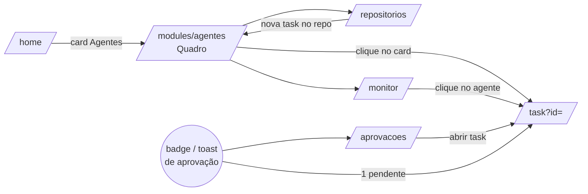
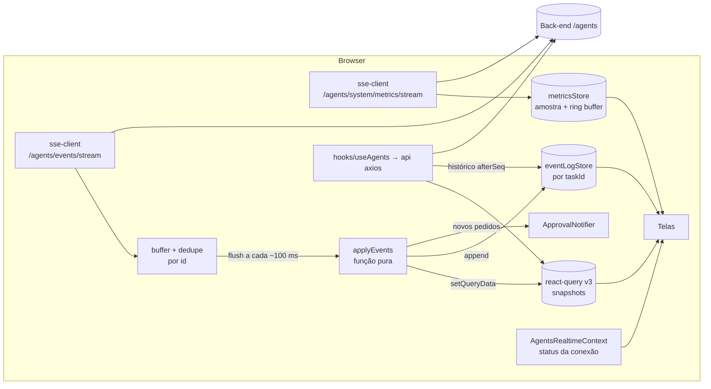
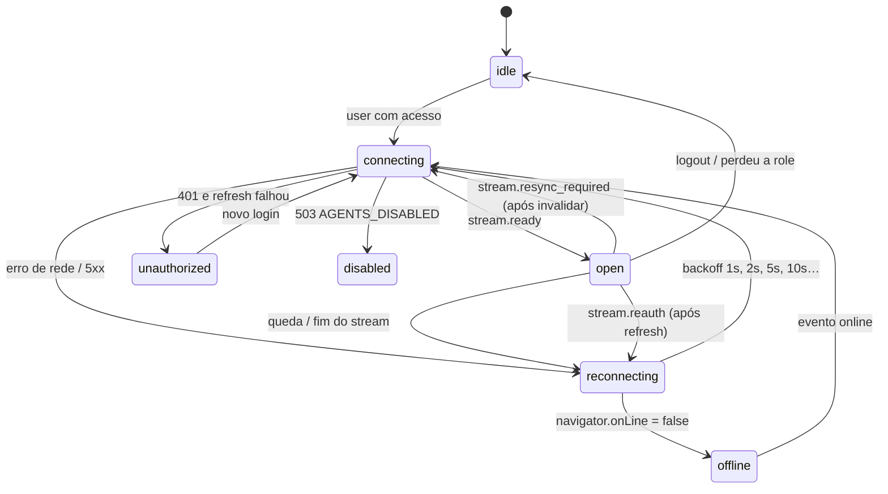
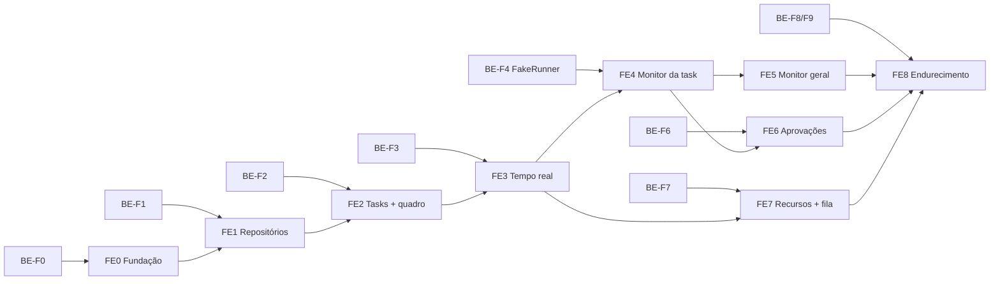

# Especificação: Gerenciador de agentes de IA (front-end)

> Status: **proposta (não implementada)**. Base: `CLAUDE.md`, `docs/frontend/*.md`, o código em `src/` (estado de 2026-10-19)
> e a seção 9 (Contrato da API) de `docs/features/gerenciador-de-agentes-backend.md`, tratada como **fonte de verdade**.
> Itens marcados como _a confirmar_ são suposições. Lacunas do contrato estão na seção 10.2 e **não** foram inventadas
> no desenho: onde falta algo, o front usa um contorno explícito e marcado.

## Sumário

1. [Visão geral e fora da v1](#1-visão-geral-e-fora-da-v1)
2. [Encaixe no front-end existente](#2-encaixe-no-front-end-existente)
3. [Telas e rotas](#3-telas-e-rotas)
4. [Componentes](#4-componentes)
5. [Estado e dados](#5-estado-e-dados)
6. [Fluxo de aprovação na interface](#6-fluxo-de-aprovação-na-interface)
7. [Carregamento, vazio e erro por tela](#7-carregamento-vazio-e-erro-por-tela)
8. [Desempenho](#8-desempenho)
9. [Acessibilidade e responsividade](#9-acessibilidade-e-responsividade)
10. [Riscos, decisões em aberto, lacunas do contrato e perguntas](#10-riscos-decisões-em-aberto-lacunas-do-contrato-e-perguntas)
11. [Plano de implementação](#11-plano-de-implementação)

---

## 1. Visão geral e fora da v1

Novo módulo **Agentes** (`/modules/agentes`), liberado pela role `Agentes` (ou `ADMIN`). O usuário:

1. **importa repositórios** por URL HTTPS e acompanha o clone (`cloning → ready`);
2. **cria tasks** (título + instrução) para um repositório e as acompanha num **quadro kanban** com os 7 status
   (`pending`, `queued`, `running`, `waiting_approval`, `done`, `failed`, `cancelled`);
3. **coloca agentes para trabalhar enquanto outros já trabalham**: cada task ativa é um agente; criar ou enfileirar uma task
   adiciona um agente à fila, e o quadro mostra posição na fila e motivo de bloqueio;
4. **monitora em tempo real** cada agente (mensagens, comandos e saídas, ferramentas, arquivos alterados) via **SSE**;
5. **responde aprovações e perguntas** (aprovar, negar, editar o comando ou responder), com notificação visível em qualquer tela do app;
6. **vê CPU e memória** em tempo real, com alerta de sobrecarga e indicação de que a fila está segurando novas tasks.

> **Terminologia.** O contrato não tem uma entidade "agente": um agente é **a execução de uma task**, com um processo
> por task ativa (back-end, seção 6.2). Na UI, "agente" = task em `running` ou `waiting_approval`; "adicionar agente" =
> criar/enfileirar task. Se você quiser agentes como perfis nomeados (ex.: "Revisor", com modelo e preset próprios), isso
> não existe no contrato (ver 10.2, L19).

### Objetivos da v1 (front)

| # | Objetivo | Critério observável |
|---|---|---|
| F1 | Módulo visível só com a role | Usuário sem `Agentes`/`ADMIN` não vê menu, card da home nem rotas (redireciona para `/home`) |
| F2 | Repositórios | Importar → card em "Clonando" → "Pronto" sem recarregar a página |
| F3 | Quadro de tasks | Cada task aparece na coluna do seu status; ações respeitam `allowedActions` |
| F4 | Tempo real confiável | Desconectar a rede por 1 min e voltar: a tela converge para o estado do servidor, sem eventos duplicados no log |
| F5 | Monitor por agente | Log ao vivo com mensagens, comandos, saídas e arquivos alterados; rolagem fluida com 10 000 eventos |
| F6 | Aprovações | Pedido aparece em ≤ 2 s em qualquer tela do app (badge + toast); responder retoma o agente |
| F7 | Recursos | CPU/memória atualizados a cada amostra; banner quando a admissão está bloqueada, com o motivo |

### Fora da v1

- **Arrastar e soltar** no kanban (as transições são poucas e ficam em botões/menus; ver 9).
- Renderização rica de **markdown** nas mensagens do agente e **realce de sintaxe** no diff (v1: texto pré-formatado; ver D-F6).
- **Notificações fora do app** (Web Push com a aba fechada, e-mail, WhatsApp). O back-end também deixa isso fora da v1.
- Coordenação entre várias abas (uma única conexão SSE compartilhada via `BroadcastChannel`); cada aba abre a própria.
- Histórico persistido de métricas: o front só mostra um buffer em memória dos últimos minutos, porque o back-end não guarda histórico.
- Tudo que o back-end deixa fora da v1: push/PR/merge, credenciais de repositórios privados (depende de D5), follow-up de
  task `done`, agendamento, edição dos limites de concorrência, streaming token a token, blocos de pensamento.
- Visão de admin sobre tasks de outros usuários (o contrato não permite; ver L12).
- Fila offline de respostas (responder sem conexão e enviar depois).
- Fallback por polling quando o SSE não funciona (ver D-F9).

---

## 2. Encaixe no front-end existente

### 2.1 O que muda em arquivos existentes

| Arquivo | Mudança |
|---|---|
| `src/config/module-access.ts` | `ModuleKey` ganha `"agentes"`; `MODULE_ROLES.agentes = ["AGENTES"]`. `normalizeRoleName` já transforma `Agentes` em `AGENTES`, e `ADMIN` continua liberando tudo |
| `src/config/modules-nav.ts` | Novo item `{ nome: "Agentes", descricao: "Repositórios, tasks e agentes de IA", icon, moduleKey: "agentes", rota: "modules/agentes" }` |
| `src/componnents/menu.tsx` **e** `src/componnents/menu-mobile.tsx` | Novo item em **cada** cópia de `menuOpcoes` (armadilha documentada no `CLAUDE.md`). `nome: "Agentes"` casa com `pathname.includes("agentes")`. Subpáginas: Quadro, Repositórios, Monitor, Aprovações. Badge com o número de aprovações pendentes ao lado do nome |
| `src/app/home/page.tsx` | `getModuleStat("agentes")`: "N aguardando aprovação" (destaque) ou "N em execução" |
| `src/app/layout.tsx` | Monta o `AgentsRealtimeProvider` **dentro** do `ChakraProvider`, porque ele precisa do `QueryClient` e de `useToast`. Ele só conecta se `hasModuleAccess(user, "agentes")` (ver D-F1) |

O resto do código existente não muda. Os ajustes **opcionais** em componentes compartilhados estão em 4.2.

### 2.2 Arquivos novos (visão geral)

```
src/
  app/modules/agentes/
    layout.tsx                    Protected + RequireModuleAccess module="agentes" (padrão de tarefas/layout.tsx)
    page.tsx                      Quadro (kanban) + resumo de recursos
    repositorios/page.tsx         Lista e importação
    task/page.tsx                 Monitor de uma task (?id=<uuid>)
    monitor/page.tsx              Todos os agentes ativos + painel de recursos
    aprovacoes/page.tsx           Central de aprovações pendentes
  componnents/agentes/            componentes da seção 4 (mantém a grafia "componnents")
  hooks/useAgents.ts              repositórios, tasks, aprovações, sistema (padrão useX → funções async)
  realtime/                       cliente SSE, provider, aplicador de eventos, stores (seção 5)
    sse-client.ts  agents-realtime-provider.tsx  apply-event.ts  event-log-store.ts  metrics-store.ts
  types/agents-types.ts           cópia literal dos tipos da seção 9.2 do back-end + tipos de payload por evento
  schemas/agents.schema.ts        Yup: importar repositório, criar/editar task
  utils/agents-labels.ts          rótulos e cores de status, statusReason, AdmissionReason, códigos de erro
  utils/agents-errors.ts          getAgentsErrorMessage(error, fallback)
```

`src/realtime/` é uma pasta nova: o projeto não tem nada parecido hoje. Todas as páginas são `"use client"`, como as atuais.

### 2.3 Padrões existentes reaproveitados

| Necessidade | Reaproveita | Arquivo de referência |
|---|---|---|
| Guard de módulo | `Protected` + `RequireModuleAccess` no `layout.tsx` | `src/app/modules/tarefas/layout.tsx` |
| Shell da página | `<Flex>` raiz + `<MenuMobile />` + `<Menu />` | qualquer `page.tsx`, ex. `src/app/modules/notificacoes/page.tsx` |
| Chamadas HTTP | instância `api` (baseURL, `X-API-Key`, cookies, refresh em 401) | `src/services/apiSetup.ts` |
| Hook de domínio | `useX()` devolvendo funções async que retornam `AxiosResponse` | `src/hooks/useAdmin.ts` |
| Leitura com cache | `useQuery({ queryKey, queryFn, enabled })` (react-query **v3**) | `src/app/home/page.tsx` |
| Invalidação | `useQueryClient().invalidateQueries` | `src/hooks/useMovements.ts` |
| Escrita | `try/catch` + `useState(isLoading)` + toast `position: "top"` + `refetch` | `src/componnents/financial/modal-categoria.tsx` |
| Mensagem por status HTTP | função `errorMessage(error, fallback)` | `src/app/modules/admin/papeis/page.tsx` (vira `getAgentsErrorMessage`, que usa o campo `code` do contrato) |
| Confirmação destrutiva | `AlertDialog` com `leastDestructiveRef`, aberto por "item ≠ null" | `src/componnents/financial/modal-confirmar-exclusao-movimento.tsx` |
| Modal criar/editar | um modal decide pelo `id` do item; `useFormik({ enableReinitialize: true })` | `src/componnents/atividades/tarefa-modal.tsx` |
| Validação | Yup + mensagem vermelha abaixo do campo | `src/schemas/auth.schema.ts`, `src/app/modules/primeiro-acesso/page.tsx` |
| Badge de categoria/status | `Badge colorScheme={...}` com função de cor | `getMethodColor` em `src/app/modules/notificacoes/page.tsx` |
| Cards de indicador | layout dos três cards | `src/componnents/atividades/quadros.tsx` |
| Cabeçalho de tabela e linhas zebradas | `bg="menu_principal"` + `surface.stripe.odd/even` | `src/app/modules/admin/usuarios/page.tsx` |
| Paginação | botões numerados | `src/app/modules/financeiro/movimentacoes/page.tsx` (com a correção de limites citada na 4.1) |
| Gráfico | Victory com cores via `var(--chakra-colors-…)` | `src/componnents/financial/grafico-salario-despesas.tsx` (o sparkline usa `VictoryArea`, sem dependência nova) |
| Botões e inputs | `DefaultButton`, `DefaultInput`, `DefatultTextarea` | `src/componnents/` |
| Esconder scrollbar | `ScrollBarcss` | `src/utils/scroll-bar-css.tsx` |
| Cores com dark mode | tokens `surface.*`, `text.*`, `border.default`, `accent.text` | `src/app/mytheme.ts` |
| Animação de entrada | `motion(Box)` + `useReducedMotion` | `src/app/home/page.tsx` |

### 2.4 Onde o módulo novo foge do padrão atual (e por quê)

| Padrão atual | No módulo novo | Motivo |
|---|---|---|
| `queryKey` plana (`["panels", userId]`) | Hierárquica com prefixo `"agents"` (`["agents", "task", id]`) | Permite `invalidateQueries(["agents"])` no resync e no logout, pelo casamento de prefixo da v3 |
| Só `refetch` após escrita | `setQueryData` a partir da resposta da mutação **e** dos eventos SSE | Tempo real; refetch a cada evento seria caro (ver 8) |
| Erros de leitura ignorados | Estado de erro visível com "Tentar de novo" | Telas ao vivo precisam explicar quando estão desatualizadas |
| `onClick` em `<Icon>` | `IconButton` com `aria-label` | Acessibilidade mínima (ver 9) |
| `useSearchParams()` sem `<Suspense>` | Páginas novas envolvem o conteúdo em `<Suspense>` | Evita o problema de build _a confirmar_ registrado em `docs/frontend/arquitetura.md` |
| Sem testes | Testes unitários do aplicador de eventos (ver D-F8) | É a parte com mais casos de borda e é pura |
| Sem dependências de tempo real | Novas: cliente SSE e virtualização (ver D-F2, D-F3) | O `EventSource` nativo não envia header de API key; logs longos exigem virtualização |

### 2.5 Integração com a autenticação existente

- A API key vai no header `X-API-Key` (o contrato aceita `x-api-key`; headers não diferenciam maiúsculas). Também vale para o SSE com cliente baseado em `fetch`.
- Cookies: `withCredentials: true` no axios e `credentials: "include"` no SSE. O envio de cookies `sameSite: none` + `partitioned`
  num stream cross-site (front na Vercel, API no Railway) está _a confirmar_ (back-end 7.4 e R8).
- O interceptor de refresh de `apiSetup.ts` **não cobre** o SSE, que não passa pelo axios. O cliente SSE trata `401` na abertura
  e `stream.reauth` chamando `api.post("auth/refresh")` (a chamada passa pelo axios, mas fica fora da lógica de retry porque a
  URL contém `auth/refresh`) e reconectando com o cursor. Se o refresh falhar, o stream vai para o estado `unauthorized` e para
  de tentar. O que fazer com a sessão nesse caso é a D-F10.
- Logout (`AuthContext.signOut`): o provider fecha os streams e chama `queryClient.removeQueries(["agents"])` quando `user` vira `null`.

---

## 3. Telas e rotas

### 3.1 Mapa

| Rota | Novo/alterado | Objetivo |
|---|---|---|
| `/modules/agentes` | novo | **Quadro**: kanban de tasks (filtro por repositório), ações rápidas, resumo de recursos e da fila |
| `/modules/agentes/repositorios` | novo | Importar, listar, editar (nome, allowlist de Bash), atualizar (fetch) e excluir repositórios |
| `/modules/agentes/task?id=<uuid>` | novo | **Monitor da task**: log ao vivo, aprovações pendentes, arquivos alterados, diff, metadados e ações |
| `/modules/agentes/monitor` | novo | **Monitor geral**: todos os agentes ativos lado a lado, mais o painel de recursos completo |
| `/modules/agentes/aprovacoes` | novo | **Central de aprovações**: todas as pendentes, mais antigas primeiro |
| `/home` | alterado | Card do módulo com estatística e atalho "Nova task" |
| Menu desktop e mobile | alterado | Item "Agentes" com subpáginas e badge de pendências |

Parâmetros de URL seguem o padrão atual (`?id_panel=`, `?date=`): `?repo=<repositoryId>` no quadro e `?id=` na task. O projeto
não usa segmentos dinâmicos (`[id]`); se você preferir `/modules/agentes/tasks/[id]`, é a D-F7.



### 3.2 Quadro — `/modules/agentes`

Objetivo: ver e controlar todas as tasks por status e adicionar agentes enquanto outros trabalham.

```
┌ Menu ┐ ┌────────────────────────────────────────────────────────────────────────────┐
│      │ │ Agentes                          [Repositório: Todos ▾]   [+ Nova task]    │
│      │ │ ┌ Recursos ───────────────────────────────────────────────────────────────┐ │
│      │ │ │ CPU 62% ▁▂▃▅▆  Mem 71% ▃▃▄▄▅   Agentes 2/2 (limite efetivo 2)  ● ao vivo │ │
│      │ │ │ ⚠ A fila está segurando novas tasks: CPU alta (média 78%)               │ │
│      │ │ └─────────────────────────────────────────────────────────────────────────┘ │
│      │ │ Pendente │ Na fila (3) │ Executando (1) │ Aguardando (1) │ Concluída │ Falhou │ Cancelada │
│      │ │ ┌──────┐ │ ┌─────────┐ │ ┌────────────┐ │ ┌────────────┐ │ ┌───────┐ │        │           │
│      │ │ │Título│ │ │#1 Título│ │ │Título      │ │ │Título  🔔 2│ │ │Título │ │  ...   │   ...     │
│      │ │ │repo  │ │ │bloq: CPU│ │ │12m · $0,42 │ │ │[Responder] │ │ │+12 −3 │ │        │           │
│      │ │ │[Fila]│ │ │[Tirar]⋮ │ │ │[Cancelar] ⋮│ │ │[Cancelar] ⋮│ │ │       │ │        │           │
│      │ │ └──────┘ │ └─────────┘ │ └────────────┘ │ └────────────┘ │ └───────┘ │        │           │
│      │ │          │             │                │                │ [ver mais]│[ver +] │ [ver mais]│
└──────┘ └────────────────────────────────────────────────────────────────────────────┘
```

- Colunas em ordem fixa. As ativas (`queued`, `running`, `waiting_approval`) mostram todas as tasks; as terminais e `pending` carregam
  20 por vez com "ver mais" (ver 5.4).
- `queued` é ordenada por `queuePosition` (1 = próxima), com o motivo `blockedBy` traduzido.
- O card mostra título, nome do repositório, `baseBranch → branchName`, tempo ativo (`activeMs`), custo (`costUsd`), contagem de
  aprovações pendentes (`pendingApprovals`) e `statusReason` traduzido em `failed`/`cancelled`.
- As ações vêm só de `allowedActions`: enfileirar, tirar da fila, cancelar, tentar de novo, editar (em `pending`), excluir
  e alterar prioridade (`pending`/`queued`). Clique no card abre `/task?id=`.
- **Mobile** (abaixo de `md`): em vez de colunas lado a lado, `Tabs` com uma aba por status, com contador.

### 3.3 Repositórios — `/modules/agentes/repositorios`

```
┌ Menu ┐ ┌──────────────────────────────────────────────────────────────────┐
│      │ │ Repositórios                               [+ Importar]          │
│      │ │ Nome      URL                       Status       Tasks     Ações │
│      │ │ projeto   github.com/u/projeto      ● Pronto     2▶ 1⏸ 5✓  ⟳ ✎ 🗑 │
│      │ │ api       github.com/u/api          ◌ Clonando…  —         — ✎ —  │
│      │ │ lib       github.com/u/lib          ✖ Erro: ...  —         ⟳ ✎ 🗑 │
│      │ │                         « 1 2 »                                  │
└──────┘ └──────────────────────────────────────────────────────────────────┘
```

- Importar (modal): `gitUrl` (obrigatório, `https://`), `name` (opcional, preenchido com o último segmento da URL) e
  `allowedBashCommands` (lista editável de regras, ex. `Bash(npm test:*)`; sintaxe _a confirmar_ no back-end).
- Linha: status com spinner em `cloning`/`fetching` e `statusMessage` em `error`; contagens de `taskCounts`;
  `defaultBranch`; tamanho (`sizeBytes`, string → MB); `lastFetchedAt`.
- Ações: **Atualizar** (`POST /fetch`; desabilitado em `cloning`/`fetching`; em `error`, ver L9), **Editar** (nome e allowlist),
  **Nova task** (abre o modal já com o repositório) e **Excluir** (confirmação; desabilitado com tasks ativas, ou seja,
  `taskCounts.queued + running + waiting_approval > 0`).

### 3.4 Monitor da task — `/modules/agentes/task?id=`

Objetivo: acompanhar um agente em detalhe e agir sobre ele.

```
┌ Menu ┐ ┌──────────────────────────────────────────────────────────────────────────────┐
│      │ │ ← Quadro   Corrigir validação do login   [● Executando]   [Cancelar] [⋮]     │
│      │ │ projeto · develop → agent/8b0c-corrigir · opus · safe · 12m03s · $0,42 · t.3 │
│      │ │ ┌ 🔔 Aprovação pendente (1 de 2) ─────────────────────────────────────────┐   │
│      │ │ │ O agente quer rodar:  npm test -- --runInBand        expira em 23h59    │   │
│      │ │ │ [Aprovar] [Editar e aprovar] [Negar…]                                   │   │
│      │ │ └─────────────────────────────────────────────────────────────────────────┘   │
│      │ │ [Atividade] [Arquivos (3)] [Diff] [Detalhes]       Filtro: ☑msg ☑cmd ☑arq ☐tool │
│      │ │ ┌─────────────────────────────────────────────────────────────────────────┐   │
│      │ │ │ 22:10:01  ▶ Sessão iniciada (opus, safe)                                │   │
│      │ │ │ 22:10:04  💬 Vou procurar o DTO de login...                             │   │
│      │ │ │ 22:10:05  $ npm test                       [saída ▾ 48 linhas]          │   │
│      │ │ │ 22:10:09  ✎ modificado src/modules/auth/dto/login.dto.ts                │   │
│      │ │ │ ...                                         (lista virtualizada)        │   │
│      │ │ └───────────────────────────── [↓ Ir para o fim (12 novos)] ──────────────┘   │
└──────┘ └──────────────────────────────────────────────────────────────────────────────┘
```

- Cabeçalho: título, `TaskStatusBadge`, metadados e ações (de `allowedActions`). "Cancelar" usa `AlertDialog` e, com resposta
  `202`, mostra "Cancelando…" até chegar `task.status_changed → cancelled`.
- Faixa de aprovações: todas as pendentes desta task (mais antigas primeiro), cada uma com `ApprovalCard`.
- Aba **Atividade**: `EventLog` com histórico (REST) + ao vivo (SSE); filtros por tipo; acompanha o fim automaticamente, a menos
  que o usuário role para cima.
- Aba **Arquivos**: `GET /changes` (lista com `+`/`−` e status). É recarregada ao receber `agent.file_changed` (com
  debounce) e `agent.changes_summary`.
- Aba **Diff**: `GET /diff?path=` do arquivo selecionado, ou o diff completo. Texto pré-formatado, com linhas `+`/`−` coloridas,
  virtualizado e com aviso de truncado.
- Aba **Detalhes**: prompt completo, modelo, preset, timeout, `maxTurns`, `attempt`, datas, `errorMessage` e `resultSummary`.
- `pending`: "Editar" abre o `TaskFormModal` em modo edição.

### 3.5 Monitor geral — `/modules/agentes/monitor`

Objetivo: ver **cada agente ativo** ao mesmo tempo e o uso da máquina.

```
┌ Menu ┐ ┌──────────────────────────────────────────────────────────────────┐
│      │ │ Monitor                                          ● ao vivo        │
│      │ │ ┌ CPU ────────────┐ ┌ Memória ─────────┐ ┌ Fila ───────────────┐   │
│      │ │ │ 62% (média 58%) │ │ 71% · 4,6/16 GB  │ │ 2/2 ativos · 3 fila │   │
│      │ │ │ ▁▂▃▅▆▅▃▂▃▅      │ │ ▃▃▄▄▅▅▅▅▆▆      │ │ admissão: CPU alta  │   │
│      │ │ └─────────────────┘ └──────────────────┘ └─────────────────────┘   │
│      │ │ ┌ Corrigir login ● Executando ┐ ┌ Atualizar deps 🔔 Aguardando ┐  │
│      │ │ │ CPU 34% · 512 MB · 12m       │ │ CPU 1% · 380 MB · 4m        │  │
│      │ │ │ $ npm test                   │ │ 🔔 quer rodar: npm install   │  │
│      │ │ │ ✎ login.dto.ts               │ │ [Responder]                 │  │
│      │ │ │ 💬 Testes passando...        │ │                             │  │
│      │ │ │            [Abrir] [Cancelar]│ │            [Abrir] [Cancelar]│  │
│      │ │ └──────────────────────────────┘ └─────────────────────────────┘  │
└──────┘ └──────────────────────────────────────────────────────────────────┘
```

- Um `AgentTile` por task em `running`/`waiting_approval`, com as últimas ~8 atividades (cauda curta, sem histórico completo),
  CPU/RSS vindos de `metrics.perAgent` e atalhos.
- Abaixo dos tiles: lista compacta da fila (`queued`, por `queuePosition`).
- Grade: 1 coluna no mobile, 2 em `lg`, 3 em `xl`.

### 3.6 Central de aprovações — `/modules/agentes/aprovacoes`

```
┌ Menu ┐ ┌──────────────────────────────────────────────────────────────────┐
│      │ │ Aprovações pendentes (3)                                         │
│      │ │ ┌ Corrigir login · projeto ───────────── há 2 min · expira 23h58 ┐ │
│      │ │ │ Comando: npm test -- --runInBand                              │ │
│      │ │ │ [Aprovar] [Editar e aprovar] [Negar…]          [Abrir task →] │ │
│      │ │ └───────────────────────────────────────────────────────────────┘ │
│      │ │ ┌ Atualizar deps · api ──────────────────────────────── há 5 min ┐ │
│      │ │ │ Pergunta: Qual gerenciador de pacotes usar?                   │ │
│      │ │ │ ( ) npm — padrão do projeto   ( ) pnpm — mais rápido          │ │
│      │ │ │ [Responder]                                    [Abrir task →] │ │
│      │ │ └───────────────────────────────────────────────────────────────┘ │
└──────┘ └──────────────────────────────────────────────────────────────────┘
```

- Fonte: `GET /agents/approvals?status=pending` (mais antigas primeiro), atualizada por SSE.
- Mesmo `ApprovalCard` da página da task, com o contexto da task (título, repositório) e link para ela.

### 3.7 Home e menu

- Card "Agentes" em `modulesNav`. Estatística: se houver pendências, "N aguardando aprovação"; senão, "N em execução"
  (`metrics.agents.running`, ou a contagem do cache).
- Atalho "Nova task" ao lado de "Novo lançamento"/"Nova tarefa", com o mesmo estilo âmbar de `DefaultButton`.
- Menu: badge numérico de pendências no acordeão "Agentes" (desktop e mobile) e indicador de conexão do stream (ponto discreto)
  dentro do módulo.

---

## 4. Componentes

### 4.1 Novos (`src/componnents/agentes/`)

| Componente | Props principais | Estado interno | Responsabilidade |
|---|---|---|---|
| `TaskStatusBadge` | `status: TaskStatus`, `reason?: string \| null` | — | `Badge` com rótulo pt-BR e `colorScheme` (padrão `getMethodColor`). Texto sempre presente (não só cor) |
| `RepositoryStatusBadge` | `status: RepositoryStatus`, `message?` | — | Idem, com `Spinner` em `cloning`/`fetching` e `Tooltip` com `statusMessage` |
| `TaskBoard` | `tasksByStatus: Record<TaskStatus, Task[]>`, `repositoriesById`, `loadMore(status)`, `hasMore: Record<…>` | — | Layout das colunas (desktop) ou `Tabs` (mobile) |
| `TaskColumn` | `status`, `tasks`, `count`, `onLoadMore?`, `isLoading` | — | Cabeçalho com contador, lista e "ver mais" |
| `TaskCard` | `task: Task`, `repositoryName`, `onOpen()` | `pendingAction: string \| null` | Resumo e botões de `allowedActions`; chama `useTaskActions` |
| `TaskActionsMenu` | `task`, `onEdit()`, `onDelete()` | — | `Menu` do Chakra com as ações secundárias (prioridade, editar, excluir) |
| `TaskFormModal` | `isOpen`, `onClose`, `task?` (edição), `defaultRepositoryId?`, `onSaved(task)` | Formik + Yup; branches via `useQuery` | Criar/editar task: repositório (só `ready`), `baseBranch` (`GET /branches`), título, prompt (`DefatultTextarea`), modelo, preset (`autonomous` só para ADMIN), timeout, `maxTurns`, prioridade, `autoStart` ("Iniciar agora"). "Avançado" recolhido |
| `RepositoryFormModal` | `isOpen`, `onClose`, `repository?`, `onSaved(repo)` | Formik + Yup | Importar (`POST`) ou editar (`PATCH`); editor da allowlist |
| `AllowlistEditor` | `value: string[]`, `onChange(v)` | input do item novo | Lista de regras com adicionar/remover (chips) |
| `ConfirmDialog` | `isOpen`, `title`, `body: ReactNode`, `confirmLabel`, `isLoading`, `onConfirm`, `onClose`, `children?` | `cancelRef` | `AlertDialog` genérico, no formato dos `modal-confirmar-exclusao-*` (que continuam como estão). Usado para cancelar task, excluir task (checkbox "apagar a branch" → `deleteBranch`), excluir repositório e negar com mensagem |
| `EventLog` | `taskId`, `filters: Set<EventGroup>`, `follow: boolean`, `onFollowChange` | posição de rolagem, itens expandidos | Lista **virtualizada** dos eventos da task, lidos do `eventLogStore`; carrega o histórico; mostra "Ir para o fim (N novos)" |
| `EventItem` | `event: AgentEvent`, `expanded`, `onToggle` | — | Renderiza um evento por `type` (tabela em 4.3); textos sempre como texto, nunca HTML |
| `CommandOutput` | `command`, `output`, `truncated`, `isError` | recolhido/expandido | Bloco monoespaçado; mostra até 20 linhas e depois "ver tudo" |
| `ChangedFilesList` | `taskId`, `onSelect(path)` | — | `GET /changes`; `+`/`−` por arquivo; `WORKTREE_UNAVAILABLE` vira estado vazio explicado |
| `DiffViewer` | `taskId`, `path?` | — | `GET /diff` (texto); linhas virtualizadas, coloridas por prefixo; aviso de `# diff truncado` |
| `ApprovalCard` | `approval: Approval`, `task?: Pick<Task,'id'\|'title'\|'repositoryId'>`, `showTaskLink?` | `mode: 'view' \| 'editing' \| 'denying'`, `editedInput`, `denyMessage`, `answers`, `isSubmitting`, `localExpired` | Mostra o pedido (ferramenta + input, ou perguntas) e envia a resposta. Trata todos os erros da seção 6 |
| `ApprovalQuestionForm` | `questions`, `value`, `onChange` | — | `RadioGroup` (ou `CheckboxGroup` se `multiSelect`) por pergunta, com `header`, `label` e `description` |
| `ExpiresIn` | `expiresAt: string` | tick a cada 30 s | "expira em 23h58"; vira "expirada" localmente (ver 6.3) |
| `ApprovalNotifier` | — (montado pelo provider) | ids já notificados | Toast persistente para cada `approval.requested`/`agent.question` novo, contador no `document.title` e, opcionalmente, Notification do browser (D-F4) |
| `ResourcePanel` | `variant: 'compact' \| 'full'` | — | Lê o `metricsStore`: CPU (instantâneo + média), memória, agentes ativos/limite, motivo da admissão e banner de pressão |
| `ResourceSparkline` | `samples: number[]`, `max = 100`, `label` | — | `VictoryArea` pequeno, sem eixos, com `aria-label` resumindo o valor atual |
| `AdmissionBanner` | `admission`, `pressure?` | — | `Alert` (warning/error) com o texto do motivo ("A fila está segurando novas tasks: memória baixa") |
| `AgentTile` | `task: Task`, `perAgent?: { cpuPercent, rssMb }` | — | Tile do monitor geral; cauda curta do `eventLogStore` (últimos 8 eventos de exibição) |
| `StreamStatusIndicator` | — | — | Ponto + texto: "ao vivo", "reconectando…", "offline", "sessão expirada"; com `aria-live="polite"` |
| `AgentsDisabledState` | — | — | Tela de 503 `AGENTS_DISABLED`: "O módulo de agentes está desligado no servidor" |
| `Paginacao` | `page`, `totalPages`, `onChange` | — | Mesma aparência da paginação de movimentações, mas **respeitando** os limites (1…`totalPages`) e com `aria-label`/`aria-current`. Fica em `componnents/agentes/`, sem mudar a tela de movimentações |

Hooks de UI (em `src/componnents/agentes/` ou `src/hooks/`):
- `useTaskActions(task)`: `enqueue`, `dequeue`, `cancel`, `retry`, `remove`, `setPriority`. Cada um faz `try/catch`, toast,
  `setQueryData` com a `Task` da resposta (regra de versão da 5.5) e trata `409 INVALID_TRANSITION` refazendo o GET da task.
- `useRespondApproval()`: envia `POST /approvals/:id/respond` e aplica `{ approval, task }` da resposta.
- `useAgentsAccess()`: `{ canUse: hasModuleAccess(user, "agentes"), isAdmin: hasModuleAccess(user, "admin") }`. O `isAdmin`
  decide se o preset `autonomous` aparece (o back-end responde `403 PRESET_NOT_ALLOWED` de qualquer jeito).

### 4.2 Existentes reutilizados ou ajustados

| Componente | Uso | Ajuste |
|---|---|---|
| `Menu`, `MenuMobile` | shell | Novo item e badge (2.1). O switch de modo escuro do mobile continua como está (fora do escopo) |
| `Protected`, `RequireModuleAccess` | `agentes/layout.tsx` | nenhum |
| `DefaultButton` | ações principais | **Opcional**: tipar `w` como `ResponsiveValue<string>` para tirar o `as any` usado em notificações/perfil. Sem isso, usar o mesmo cast |
| `DefaultInput` | campos simples | **Opcional**: prop `error?: string` (mensagem abaixo do campo, como em `primeiro-acesso`). Sem isso, a página renderiza o erro ao lado, como hoje |
| `DefatultTextarea` | prompt da task | **Opcional**: repassar `rows`/`maxLength`. O nome com erro de digitação é mantido |
| `Quadros` | — | não é reaproveitado diretamente (é específico de tarefas); o `ResourcePanel` copia o layout |
| `FirstScreen`, componentes financeiros e de tarefas | — | não envolvidos |

Os ajustes opcionais são aditivos (props novas, opcionais) e não mudam o comportamento das telas atuais.

### 4.3 Renderização de cada tipo de evento (`EventItem`)

| `type` | Exibição | Grupo do filtro |
|---|---|---|
| `task.created` | "Task criada" | sistema |
| `task.status_changed` | "Status: Na fila → Executando (scheduler)" + `reason` traduzido | sistema |
| `task.updated` | "Task editada: título, prioridade" | sistema |
| `worktree.created` / `worktree.removed` | "Branch `agent/…` criada a partir de `develop` (reutilizada)" | sistema |
| `agent.session_started` | "Sessão iniciada (modelo, modo) — retomada" se `resumed` | sistema |
| `agent.message` | texto (markdown mostrado como texto pré-formatado na v1; D-F6) | mensagens |
| `agent.tool_call` | "Read `src/x.ts`" (ferramenta + resumo do input; JSON completo ao expandir) | ferramentas |
| `agent.tool_result` | ícone de ok/erro + `summary` | ferramentas |
| `agent.command` | `$ comando` + `description` | comandos |
| `agent.command_result` | `CommandOutput`, ligado ao comando por `toolUseId` (fica logo abaixo dele quando possível) | comandos |
| `agent.file_changed` | "✎ modificado `path`" (criado/excluído) | arquivos |
| `agent.changes_summary` | resumo `+N −M` em N arquivos, commit `sha` | arquivos |
| `approval.requested` / `agent.question` | marcador "🔔 Pediu aprovação para Bash" (o card de ação fica na faixa de aprovações) | aprovações |
| `approval.resolved` | "Aprovado / Negado: mensagem / Respondido / Expirou / Cancelado" | aprovações |
| `agent.notice` | aviso discreto (`kind`, `message`) | sistema |
| `agent.result` | "Concluída em N turnos · US$ X · duração" ou erro com `subtype` | sistema |
| `agent.error` | `Alert` vermelho com `code` e `message` | sistema |
| tipo desconhecido | "Evento `type`" + JSON ao expandir (o back-end pode adicionar tipos sem migration) | sistema |

---

## 5. Estado e dados

### 5.1 Visão geral



### 5.2 O que é global e o que é local

**Global** (vive acima das páginas, no `AgentsRealtimeProvider` montado no root layout):

| Item | Onde | Por quê |
|---|---|---|
| Usuário e roles | `AuthContext` (existente) | decide se o módulo e os streams existem |
| Conexão do stream de eventos (`status`, cursor `lastEventId`, tentativas) | `AgentsRealtimeContext` + refs | uma conexão por aba, usada por todas as telas |
| Aprovações pendentes | cache `["agents", "approvals", "pending"]` | badge no menu, toast e home precisam disso fora do módulo |
| Snapshots de tasks, repositórios e aprovações | cache do react-query (prefixo `"agents"`) | já é o "store" do projeto; os eventos atualizam via `setQueryData` |
| Logs de eventos por task | `eventLogStore` (módulo JS + `useSyncExternalStore`) | volume alto de append; ver 8 e D-F5 |
| Métricas (última amostra + ~150 amostras) | `metricsStore` | atualização a cada 2 s sem passar pelo cache do react-query |

**Local** (`useState`/`useDisclosure`/Formik nas páginas e componentes, como hoje):
- filtro de repositório do quadro (espelhado na URL `?repo=`), aba ativa (`Tabs`), coluna aberta no mobile;
- formulários (`TaskFormModal`, `RepositoryFormModal`, edição do comando, texto da negativa, respostas de pergunta);
- modais e confirmações ("item ≠ null");
- estado de envio (`isSubmitting`, `pendingAction`);
- UI do log: filtros por grupo, `follow`, itens expandidos, arquivo selecionado no diff.

Nada vai para `localStorage`, exceto, opcionalmente, a preferência de filtros do log (D-F5 não depende disso).

### 5.3 Hooks de API (`src/hooks/useAgents.ts`)

Mesmo padrão de `useAdmin`: funções async retornando o `AxiosResponse`. Mapa 1:1 com o contrato:

| Função | Endpoint (seção do contrato) |
|---|---|
| `listRepositories(page, perPage)` | `GET /agents/repositories` (9.3) |
| `getRepository(id)` / `createRepository(body)` / `updateRepository(id, body)` / `deleteRepository(id)` | 9.3 |
| `listBranches(id)` / `fetchRepository(id)` | 9.3 |
| `listTasks({ repositoryId?, status?: TaskStatus[], page, perPage })` | `GET /agents/tasks` (`status` vira lista separada por vírgula) (9.4) |
| `getTask(id)` → `Task & { approvals }` / `createTask` / `updateTask` / `deleteTask(id, deleteBranch)` | 9.4 |
| `enqueueTask` / `dequeueTask` / `cancelTask` / `retryTask` | ações de estado (9.4) |
| `listTaskEvents(id, afterSeq, limit)` | 9.4 |
| `getTaskChanges(id)` / `getTaskDiff(id, path?)` (`responseType: "text"`) | 9.4 |
| `listApprovals({ status, taskId?, page, perPage })` / `respondApproval(id, body)` | 9.5 |
| `getMetrics()` | `GET /agents/system/metrics` (9.7), usado como snapshot inicial antes do stream |
| `getSystemConfig()` | 9.7 (só ADMIN; ver L7) |

Os streams (9.6 e 9.7) **não** passam pelo axios; ficam em `src/realtime/sse-client.ts`.

### 5.4 Cache (react-query v3)

| queryKey | Fonte | `staleTime` | Atualizado por eventos? |
|---|---|---|---|
| `["agents", "repositories", page]` | `listRepositories` | 30 s | sim (`repository.status_changed`, `task.status_changed` → `taskCounts`) |
| `["agents", "repository", id]` | `getRepository` | 30 s | sim |
| `["agents", "branches", repoId]` | `listBranches` | 5 min | invalidado ao terminar `fetching` (`repository.status_changed` → `ready`) |
| `["agents", "tasks", { repositoryId, statuses, page }]` | `listTasks` (uma query por grupo de colunas) | `Infinity` enquanto o stream estiver `open`; 0 caso contrário | sim |
| `["agents", "task", id]` | `getTask` (inclui aprovações pendentes) | `Infinity` com stream `open` | sim |
| `["agents", "approvals", "pending"]` | `listApprovals({ status: "pending", perPage: 100 })` | `Infinity` com stream `open` | sim |
| `["agents", "changes", taskId]` | `getTaskChanges` | 0 | invalidado (debounce de 2 s) por `agent.file_changed`/`changes_summary` |
| `["agents", "diff", taskId, path]` | `getTaskDiff` | 0 | invalidado junto com `changes` |
| `["agents", "config"]` | `getSystemConfig` (só se ADMIN) | `Infinity` | não |

Regras:
- **Grupos do quadro**: `active` = `queued,running,waiting_approval` (`perPage: 100`), `pending` (20 por página), e
  `done`, `failed`, `cancelled` (20 por página cada, com "ver mais" incrementando a página). O contrato só ordena por
  `createdAt DESC`; a coluna `queued` é reordenada no cliente por `queuePosition`.
- `refetchOnWindowFocus` desligado nas queries `agents`: o stream é a fonte de atualização. Quando o stream **não** está `open`,
  as telas mostram o indicador e um botão "Atualizar".
- `queryClient.invalidateQueries(["agents"])` em `stream.resync_required`, ao reconectar depois de `offline` e ao voltar de
  `unauthorized`.
- Logout: `removeQueries(["agents"])`, mais limpar `eventLogStore` e `metricsStore`.

### 5.5 Aplicação dos eventos (`src/realtime/apply-event.ts`)

Uma função pura `applyEvents(state, events)` é chamada pelo provider com lotes. Na prática, o provider lê e escreve via
`queryClient.getQueryData`/`setQueryData`, e a lógica testável fica isolada.

**Ordem e duplicação**
1. **Cursor global**: o provider guarda o maior `id` recebido, comparando com `BigInt(id)` (o id é string numérica, e comparar
   strings erra: `"999" > "1000"`). Evento com `id <= cursor` é **descartado** (duplicata do replay ou do buffer de reconexão).
   Eventos `stream.*` não têm `id` e não mexem no cursor.
2. **Versão por task**: `Task.lastEventId` vem nos snapshots REST e nas respostas de mutação. Para atualizar uma task em cache,
   o evento só é aplicado se `BigInt(event.id) > BigInt(task.lastEventId ?? 0)`; ao aplicar, o front define
   `task.lastEventId = event.id`. A mesma regra resolve a corrida "resposta da mutação × evento SSE": vale o que tiver o
   `lastEventId` maior. Isso supõe que `lastEventId` venha atualizado nas respostas de mutação (_a confirmar_, L16).
3. **Sequência por task (log)**: o `eventLogStore` guarda `lastSeq` por task. `seq <= lastSeq` → descarta; `seq > lastSeq + 1`
   → **buraco**: guarda o evento num buffer pendente e busca `GET /tasks/:id/events?afterSeq=lastSeq` até fechar o buraco,
   depois aplica o pendente. A ordem final do log é sempre por `seq`.
4. Eventos de repositório (`seq` e `taskId` nulos) não têm versão própria (L11); aplica-se o último recebido.

**Efeito de cada tipo no cache**

| Evento | Efeito |
|---|---|
| `task.created` | insere `payload.task` no grupo certo (se o filtro de repositório bate) e incrementa `taskCounts` do repositório |
| `task.status_changed` | move a task de grupo/coluna (`status = to`, `statusReason = reason`, `attempt`); ajusta `taskCounts`; **agenda** um GET da task (debounce de 300 ms por id) para atualizar `allowedActions`, `queuePosition`, `blockedBy`, `pendingApprovals`, `costUsd`, que o payload não traz (L2). Se `from` ou `to` for `queued`/`running`, agenda também o refetch do grupo `active` (debounce de 1 s), porque as posições na fila mudam (L3) |
| `task.updated` | merge de `payload.changes` |
| `approval.requested` / `agent.question` | adiciona à lista de pendentes (montando `Approval` a partir do payload e completando com GET se faltar `expiresAt`, L5); `pendingApprovals++` na task; dispara o `ApprovalNotifier` se o id ainda não foi notificado |
| `approval.resolved` | remove de pendentes; `pendingApprovals--`; fecha o card se estiver aberto em modo de edição, com toast "Respondida em outro lugar / expirou / cancelada" quando não foi esta aba que respondeu |
| `agent.result`, `agent.error` | agenda GET da task (custo, turnos, `resultSummary`, `errorMessage`) |
| `agent.file_changed`, `agent.changes_summary` | invalida `["agents","changes",taskId]` e `diff` (debounce de 2 s) |
| `repository.status_changed` | atualiza `status`, `statusMessage`, `defaultBranch`; em `ready`, invalida `branches` |
| todos os de task | `eventLogStore.append(taskId, event)` (só para tasks com log carregado ou tile visível; ver 8.1) |
| `stream.ready` | `status = open`; se houve reconexão, refetch leve do grupo `active` e das pendentes (reconciliação) |
| `stream.resync_required` | invalida `["agents"]`, limpa os logs carregados (eles recarregam pelo REST) e reconecta com o cursor novo (L1) |
| `stream.reauth` | `api.post("auth/refresh")` e reconecta com o cursor atual |

Exclusões feitas **nesta aba** removem do cache pela resposta. Exclusões em outra aba ou dispositivo não geram evento (L4) e só
somem no próximo refetch.

### 5.6 Conexão, reconexão e primeira carga



- **Cliente SSE** baseado em `fetch` + `ReadableStream` (D-F2): header `X-API-Key`, `credentials: "include"`, header
  `Last-Event-ID` com o cursor. Um único listener interpreta `data` como JSON e lê `data.type`, conforme o contrato.
  Linhas `: ping` são ignoradas, mas renovam o "último sinal". Se nada chegar em 45 s (3 pings perdidos), a conexão é tratada
  como morta e reaberta.
- **Backoff**: 1 s, 2 s, 5 s, 10 s (máximo), com jitter de ±20% para várias abas não reconectarem juntas. Zera no `stream.ready`.
- **Primeira carga** (sem cursor). O contrato não diz o que o stream faz sem cursor, nem como obter o cursor global (L1).
  Desenho proposto, válido se "sem cursor = só eventos ao vivo" (_a confirmar_):
  1. abre o stream **sem** cursor e acumula os eventos num buffer;
  2. em paralelo, carrega os snapshots REST (grupos do quadro, pendentes, repositórios);
  3. quando os snapshots chegam, aplica o buffer pela regra de versão (5.5, item 2), que descarta o que o snapshot já reflete.
  Se o back-end, em vez disso, fizer replay desde o início, o desenho precisa de um cursor inicial vindo do REST (pedido em L1).
- **Aba em segundo plano**: o stream de eventos **continua** aberto (para notificar aprovações); o de métricas **fecha** com
  `document.visibilityState = "hidden"` e reabre ao voltar (métricas não têm replay; ver 8.3).
- **Log de uma task aberta**: carrega o histórico com `GET /tasks/:id/events?afterSeq=0&limit=1000` em páginas até
  `hasMore = false`, aplicando os eventos ao vivo que chegarem enquanto isso pela regra de `seq`. Não abre um stream separado
  com `taskId`: o stream do usuário já traz tudo, e um segundo stream gastaria conexão (ver 8.2 e L20).

### 5.7 Erros

`src/utils/agents-errors.ts` exporta `getAgentsErrorMessage(error, fallback)`, que lê `error.response.data.code` (contrato 9.1) e devolve pt-BR:

| code | Mensagem |
|---|---|
| `VALIDATION_ERROR` | junta `message[]` |
| `GIT_URL_NOT_ALLOWED` | "Use uma URL https:// pública, sem usuário e senha" |
| `MODEL_NOT_ALLOWED` | "Modelo não permitido" |
| `PRESET_NOT_ALLOWED` | "Só administradores podem usar o modo autônomo" |
| `NOT_FOUND` | "Não encontrado (pode ter sido excluído)" (e remove do cache) |
| `REPOSITORY_ALREADY_EXISTS` | "Este repositório já foi importado" |
| `REPOSITORY_NOT_READY` | "O repositório ainda não está pronto" |
| `REPOSITORY_HAS_ACTIVE_TASKS` | "Cancele ou aguarde as tasks ativas antes de excluir" |
| `BRANCH_NOT_FOUND` | "Branch não encontrada no remoto. Atualize o repositório" |
| `INVALID_TRANSITION` | "A task mudou de estado. Atualizando…" (e faz GET da task) |
| `TASK_NOT_EDITABLE` | "Só é possível editar tasks pendentes" |
| `TASK_ACTIVE` | "Cancele a task antes de excluir" |
| `WORKTREE_UNAVAILABLE` | "Os arquivos desta task já foram removidos" (estado vazio, não toast) |
| `APPROVAL_ALREADY_RESOLVED` | "Este pedido já foi respondido" |
| `APPROVAL_NOT_ACTIVE` | "O agente não está mais aguardando este pedido" |
| `APPROVAL_RESPONSE_INVALID` | "Resposta inválida para este pedido" |
| `AGENTS_DISABLED` (503) | estado de tela `AgentsDisabledState` |
| 429 | "Muitas requisições. Aguarde um pouco" (padrão do login) |
| 401 | já tratado pelo interceptor; se persistir, o fluxo de sessão existente |

---

## 6. Fluxo de aprovação na interface

### 6.1 Sequência completa

```mermaid
sequenceDiagram
  autonumber
  participant SSE as Stream de eventos
  participant P as AgentsRealtimeProvider
  participant N as ApprovalNotifier
  actor U as Usuário
  participant C as ApprovalCard
  participant API as POST /approvals/:id/respond

  SSE->>P: task.status_changed (running → waiting_approval)
  SSE->>P: approval.requested {approvalId, tool, input, expiresAt}
  P->>P: dedupe por id; adiciona a pendentes; pendingApprovals++
  P->>N: novo approvalId
  N-->>U: toast persistente + badge no menu + "(1)" no título (+ Notification opcional)
  U->>C: abre (toast, badge, central ou página da task)
  C->>C: mostra ferramenta, input, motivo, "expira em"
  alt Aprovar
    U->>C: Aprovar
    C->>API: { decision: "approve" }
  else Editar e aprovar (só Bash / tool_permission)
    U->>C: edita o comando
    C->>API: { decision: "approve", updatedInput: { ...input, command } }
  else Negar
    U->>C: Negar + mensagem opcional
    C->>API: { decision: "deny", message }
  else Pergunta
    U->>C: escolhe as opções
    C->>API: { answers: { [question]: label(s) }, message? }
  end
  C->>C: botões desabilitados + spinner (isSubmitting)
  API-->>C: 200 { approval, task }
  C->>P: setQueryData(task) e remove o pedido das pendentes
  C-->>U: toast "Resposta enviada"; card fecha
  SSE->>P: approval.resolved (dedupe: já removido)
  SSE->>P: task.status_changed (waiting_approval → running) se não restam pendentes
  SSE->>P: agent.command / agent.command_result …
```

Detalhes:
- **Onde aparece**: (a) faixa no topo da página da task; (b) central `/aprovacoes`; (c) tile do monitor; (d) botão
  "Responder" no `TaskCard` (abre um `Modal` com o `ApprovalCard`); (e) o toast tem o botão "Ver", que leva à task (1 pendente) ou à central (várias).
- **Conteúdo do `tool_permission`**: para `Bash`, o comando em bloco monoespaçado e a `description`; para Write/Edit, o caminho
  e um resumo do input (JSON completo ao expandir, nunca HTML); para WebFetch/WebSearch, a URL ou consulta, em destaque como risco.
  O `reason` vai como texto auxiliar.
- **Editar e aprovar**: só para `kind = tool_permission` e, na v1, só para o campo `command` do Bash (outros inputs são
  estruturados e grandes demais para editar com segurança na UI). Mostra o diff "original × editado" antes de enviar.
- **Negar**: abre um campo de mensagem opcional ("diga ao agente o que fazer em vez disso").
- **Pergunta**: uma pergunta por bloco, com `header` como título; opção única (radio) ou múltipla (checkbox) conforme
  `multiSelect`; `description` abaixo de cada opção; botão desabilitado até todas terem resposta. O valor enviado é o `label`
  (vários juntos com `", "` em `multiSelect`, _a confirmar_, L10). Resposta livre ("Outro") não aparece na v1 porque o contrato não a prevê (L10).
- **Notificação**: o toast usa `duration: null` (fica até ser fechado) e `id = approvalId`, conferindo `toast.isActive(id)`
  antes de abrir, para não duplicar. O badge e o título mostram o total de pendentes. A Notification do browser é opcional e só aparece com a aba em
  segundo plano (D-F4), com `tag = approvalId`, para que várias abas não empilhem a mesma notificação.

### 6.2 Casos de borda

| Caso | Comportamento |
|---|---|
| **Usuário offline quando o pedido chega** | Nada é perdido: ao reconectar, o replay entrega `approval.requested` (e, se já tiver expirado, também `approval.resolved: expired` e `task.status_changed → failed`). Os eventos são aplicados em ordem; o notificador **não** notifica pedidos que já chegam resolvidos no mesmo lote |
| **Fica offline com o card aberto** | `StreamStatusIndicator` = "offline"; o card mostra o aviso "Sem conexão: a resposta pode falhar". O envio continua possível |
| **Envio falha por rede** | Mantém o que foi digitado, toast "Não foi possível enviar. Tente de novo"; os botões voltam a ficar ativos. Não há reenvio automático (o throttle e a semântica de 409 tornam o reenvio manual mais seguro) |
| **Resposta chega ao servidor mas a confirmação se perde** | No reenvio, `409 APPROVAL_ALREADY_RESOLVED`: GET da aprovação/task e mensagem "Este pedido já foi respondido" mostrando a resposta registrada |
| **Dois pedidos simultâneos na mesma task** | A faixa lista os dois ("1 de 2"), mais antigos primeiro; cada um é respondido de forma independente. Depois do primeiro, a task continua `waiting_approval` (o back-end só volta para `running` quando todos estão resolvidos), e a UI mostra "aguardando mais 1 resposta" |
| **Pedidos simultâneos em tasks diferentes** | Central e badge com o total; um toast por pedido (até 3 visíveis; acima disso, um toast resumido "N aprovações pendentes") |
| **Mesmo pedido respondido em duas abas/dispositivos** | A segunda recebe `409 APPROVAL_ALREADY_RESOLVED`. O `approval.resolved` vindo do SSE fecha o card na outra aba com "Respondido em outro lugar" |
| **Pedido expirado** | `ExpiresIn` conta a partir de `expiresAt`. Ao chegar em zero, o card mostra "Expirado" e desabilita as ações (o relógio do cliente pode diferir do servidor; D-F11). A confirmação vem por `approval.resolved: expired` + `task.status_changed → failed (approval_timeout)`. Se a resposta for enviada pouco antes do fim e o servidor já tiver expirado: `409` e "Este pedido expirou" |
| **Servidor reiniciou** | As pendentes viram `expired` pela recuperação (back-end 6.7); responder dá `409 APPROVAL_NOT_ACTIVE`: "O agente não está mais aguardando. A task foi reenfileirada ou falhou" e GET da task |
| **Task cancelada com o card aberto** | `approval.resolved: cancelled` fecha o card ("A task foi cancelada") |
| **Clique duplo** | `isSubmitting` desabilita os botões no primeiro clique |
| **`agent.question` sem `expiresAt` no evento** | O card aparece na hora, sem contador, e o GET da aprovação completa o dado (L5) |
| **Pedido de task de outro filtro** | Notifica igual; a central não depende do filtro do quadro |

### 6.3 Regras de UI da aprovação
- O servidor decide; o front nunca resolve uma aprovação localmente sem resposta da API ou evento.
- Nenhum conteúdo do pedido é interpretado como HTML ou link clicável automaticamente (o conteúdo pode vir de prompt injection no repositório).
- "Aprovar" não é o botão em foco por padrão (`AlertDialog`/`Modal` focam o primeiro botão; a ordem fica Negar → Editar → Aprovar
  ou o foco vai para "Ver detalhes"), para evitar aprovar sem querer com Enter.

---

## 7. Carregamento, vazio e erro por tela

| Tela | Carregando | Vazio | Erro |
|---|---|---|---|
| Qualquer tela do módulo | guards retornam `null` (padrão atual) | — | `503 AGENTS_DISABLED` → `AgentsDisabledState`; 403 → o guard já redireciona; erro de rede → `Alert` + "Tentar de novo" |
| Quadro | `Skeleton` nos cards de cada coluna; `ResourcePanel` com `Skeleton` até a primeira amostra | sem repositórios: "Importe um repositório para começar" + botão; com repositórios e sem tasks: "Nenhuma task ainda" + "Nova task"; coluna vazia: texto discreto "Nenhuma" | falha de um grupo: `Alert` dentro da coluna, sem derrubar as outras; stream fora: indicador + "Atualizar" |
| Repositórios | `Spinner` central (padrão das tabelas atuais) | "Nenhum repositório importado" + "Importar" | toast nas ações; linha em `error` mostra `statusMessage` e as ações permitidas |
| Formulário de task | `Select` de branches com `Spinner` | sem repositórios `ready`: o modal explica e não deixa salvar | `BRANCH_NOT_FOUND`, `MODEL_NOT_ALLOWED`, `PRESET_NOT_ALLOWED`: erro no campo; outros: toast |
| Task (cabeçalho) | `Skeleton` | — | `404` → "Task não encontrada ou excluída" + voltar ao quadro |
| Task (log) | `Spinner` no topo enquanto pagina o histórico ("Carregando histórico… 3 000 eventos") | "O agente ainda não começou" em `pending`/`queued` (com posição e motivo) | falha ao buscar buraco de `seq`: aviso "Parte do histórico não carregou" + "Recarregar" |
| Task (arquivos/diff) | `Spinner` | "Nenhum arquivo alterado" | `WORKTREE_UNAVAILABLE` → "Os arquivos desta task foram removidos (retenção)" |
| Monitor | `Skeleton` dos tiles | "Nenhum agente trabalhando agora" + fila resumida | stream de métricas fora → "Métricas indisponíveis" nos cards de recurso, sem afetar os tiles |
| Aprovações | `Spinner` | "Nenhuma aprovação pendente" | toast nas respostas (seção 6) |
| Home (card) | `Spinner size="xs"` (padrão atual) | "0 em execução" | silencioso (padrão atual) |

---

## 8. Desempenho

### 8.1 Logs longos

- **Virtualização** com `@tanstack/react-virtual` (D-F3), com altura **dinâmica** medida (`measureElement`): mensagens e saídas
  de comando têm tamanhos variáveis. Só os itens visíveis + overscan (~10) são montados.
- **Saídas recolhidas**: `CommandOutput` mostra 20 linhas e o resto sob demanda. O payload já vem truncado em 64 KB pelo
  back-end, mas 64 KB num `<pre>` ainda é caro; "ver tudo" renderiza o bloco inteiro só daquele item.
- **Append em lote**: os eventos ao vivo vão para um buffer e são aplicados a cada ~100 ms (ou `requestAnimationFrame`), com uma
  única notificação aos assinantes por lote.
- **"Seguir o fim"**: rola para o fim só se o usuário já estava no fim; senão, mostra "Ir para o fim (N novos)".
- **`eventLogStore`** separado do react-query (D-F5): `Map<taskId, { events: AgentEvent[], lastSeq, status }>` com
  `useSyncExternalStore`. Assim, cada evento não passa por `setQueryData` + comparação estrutural do react-query.
- **Limites de memória**: logs completos só para tasks com a página aberta; ao sair, o log é descartado depois de 2 min (volta
  rápido se o usuário retornar). Tiles do monitor guardam só os últimos 50 eventos por task. Teto de 20 000 eventos por log
  aberto; acima disso, os mais antigos saem da memória com o aviso "Histórico antigo oculto. Recarregue para ver"
  (o contrato só pagina para frente; ver L8).
- **Histórico grande**: `afterSeq` com `limit=1000` em sequência. A primeira página já é renderizada; as próximas vão sendo
  acrescentadas. Sem "carregar as últimas N" no contrato (L8), uma task com 20 000 eventos exige 20 requisições para mostrar o fim.
- **React Compiler** (`reactCompiler: true`): componentes que usam `useVirtualizer` podem precisar da diretiva `"use no memo"`
  por incompatibilidade conhecida de bibliotecas com estado mutável (_a confirmar_ na implementação).
- **Diff**: até 1 MB de texto; dividido em linhas e virtualizado igual ao log.

### 8.2 Muitos agentes ao mesmo tempo

- **Uma** conexão de eventos por aba para tudo (sem stream por task): menos conexões e um único lugar de dedupe. Com HTTP/1.1,
  o browser abre no máximo ~6 conexões por origem, e 2 streams por aba × 3 abas já chegam a esse limite (L20).
- O aplicador de eventos só faz append no log de tasks com **assinante** (página aberta ou tile visível). Para as outras,
  atualiza apenas o snapshot (status e contadores).
- Refetch por evento com **debounce por task** (300 ms) e do grupo `active` (1 s): uma rajada de `status_changed` gera no máximo um GET por task.
- Cards do quadro e tiles leem a própria task do cache via `select`; um evento de uma task não re-renderiza as outras. O React
  Compiler cuida da memoização dos componentes puros.
- Colunas terminais paginadas (20 por vez) para o DOM não crescer sem limite.

### 8.3 Painel de recursos

- O servidor emite a cada `AGENTS_METRICS_INTERVAL_MS` (padrão 2 s). O front renderiza no máximo uma vez por amostra; se chegarem
  amostras mais rápido, só a última é desenhada (`requestAnimationFrame`).
- Ring buffer de 150 amostras (~5 min a 2 s) por série (CPU instantânea, CPU média, memória), só em memória; zera ao recarregar
  a página (o back-end não guarda histórico).
- O stream de métricas fica aberto **só** em telas que mostram recursos (quadro, monitor) e com a aba visível. A home usa o snapshot `GET /metrics` uma vez.
- Antes da primeira amostra do stream, `GET /agents/system/metrics` preenche o painel, para não ficar vazio por 2 s.
- **Alertas**: o banner aparece quando `admission.allowed = false` e `reason ≠ ok` (ex.: "A fila está segurando novas tasks:
  CPU alta (média 78%)"); o nível vem de `system.pressure` (`warning` → amarelo, `critical` → vermelho). O banner some quando
  uma amostra de `system.metrics` mostra `admission.allowed = true`, porque não há evento de "pressão normalizada" (L6). Para
  não piscar, o banner só some depois de 2 amostras seguidas com `allowed = true` (a histerese principal é do back-end).
- Motivos (`AdmissionReason`) traduzidos: `hard_limit` "limite de agentes atingido", `user_limit` "seu limite de agentes
  atingido", `cpu_high` "CPU alta", `memory_low` "memória insuficiente para mais um agente", `memory_critical` "memória crítica",
  `cooldown` "aguardando o agente anterior estabilizar", `runner_disabled` "execução desligada no servidor". `cooldown` é
  normal e transitório, então aparece só na task, como texto discreto, e não vira banner.

---

## 9. Acessibilidade e responsividade

Nível de referência: o projeto usa componentes do Chakra (que já trazem foco, `aria` de modais e de menus), `aria-label` no
`IconButton` do `MenuMobile` e `useReducedMotion` na home, sem uma política formal. O módulo novo segue esse nível, mais estes
pontos, que não exigem nada novo no projeto:

**Acessibilidade**
- Ações sempre em `Button`/`IconButton` com `aria-label`, nunca `onClick` em `<Icon>` (padrão existente em algumas telas, não repetido aqui).
- Status nunca só por cor: o badge tem texto; o motivo de bloqueio é texto.
- **Kanban sem arrastar**: mover entre colunas é feito pelos botões e pelo menu de ações, todos acessíveis por teclado (por isso o DnD ficou fora da v1).
- Aprovação: o `ApprovalCard` dentro de `Modal` (quadro, monitor) usa o foco do Chakra; na página da task, a faixa é uma `region`
  com título. O toast de novo pedido é anunciado (o Chakra usa `role="status"`) e o `StreamStatusIndicator` tem `aria-live="polite"`.
- O log **não** é uma região live: um leitor de tela anunciando cada evento ficaria inutilizável. Ele é uma lista navegável,
  com `aria-label="Atividade do agente"`.
- `ResourceSparkline` tem `role="img"` e `aria-label` "CPU 62%, média 58%".
- `ExpiresIn` mostra texto, não só um contador visual.
- Animações (entrada dos cards, pulso do indicador "ao vivo") respeitam `useReducedMotion`.
- Contraste: usar os tokens `text.*`, `surface.*` e `accent.text` do tema (já definidos para claro e escuro).

**Responsividade** (mesmos breakpoints do projeto: `base/sm/md/lg/xl`; o shell troca `Menu` por `MenuMobile` em `lg`)
- Quadro: colunas lado a lado com rolagem horizontal a partir de `lg`; abaixo de `md`, `Tabs` por status com contador.
- Task: cabeçalho empilha os metadados no mobile; as ações secundárias vão para o menu `⋮`; as abas viram rolagem horizontal; o diff
  e as saídas de comando rolam na horizontal dentro do bloco (sem quebrar a página).
- Monitor: grade de 1 / 2 / 3 colunas (`base` / `lg` / `xl`).
- Central de aprovações: cards em coluna única; os botões viram largura total no mobile.
- Modais com `mx={{ base: 4 }}` (padrão atual) e `size="xl"`; o formulário de task usa `size="full"` no `base`.

---

## 10. Riscos, decisões em aberto, lacunas do contrato e perguntas

### 10.1 Riscos

| # | Risco | Impacto | Mitigação |
|---|---|---|---|
| RF1 | Cookies `partitioned`/`sameSite=none` não enviados no stream cross-site (Vercel → Railway) em algum navegador | alto: sem tempo real | Testar cedo (fase FE3) nos navegadores-alvo; contorno: domínio comum para API e front (_a confirmar_) |
| RF2 | Limite de conexões HTTP/1.1 com 2 streams por aba e várias abas | médio | Um stream de eventos por aba; métricas só nas telas que mostram recursos e com a aba visível; confirmar HTTP/2 no back-end (L20) |
| RF3 | Logs muito longos (20 000+ eventos) e saídas grandes travando a página | médio | Virtualização, recolhimento, lote, teto em memória (8.1) |
| RF4 | Conteúdo malicioso vindo do repositório (prompt injection) aparecendo na UI | alto | Tudo como texto, sem HTML, sem auto-link; aprovação explícita mostrando o comando completo |
| RF5 | Divergência entre cache e servidor por evento perdido ou lacuna do contrato (L2, L3, L4) | médio | Regra de versão por `lastEventId`, refetch com debounce, reconciliação no `stream.ready`, botão "Atualizar" |
| RF6 | Bibliotecas novas incompatíveis com React 19 / React Compiler | médio | Fixar versões; `"use no memo"` onde necessário; alternativa sem dependência para o SSE (D-F2) |
| RF7 | Sem testes automatizados no front hoje | médio | Testes do aplicador de eventos (D-F8); roteiro manual de aceite por fase |
| RF8 | O provider global abre um stream para todo usuário com a role em qualquer tela | baixo | Só com a role; um stream; reconexão com jitter (D-F1) |

### 10.2 Lacunas e divergências encontradas no contrato do back-end

| # | Lacuna / divergência | Efeito no front | Pedido ao back-end |
|---|---|---|---|
| L1 | **Cursor inicial global**: o stream aceita `lastEventId`, mas nenhum endpoint devolve o último `id` do **usuário** (só por task, em `Task.lastEventId` e em `/tasks/:id/events`). Também não está definido o comportamento **sem cursor** (só ao vivo? replay desde 0, que estouraria 1000 e daria `resync_required` em loop?) | A primeira carga e a recuperação de `resync_required` dependem disso (5.6) | Definir "sem cursor = só ao vivo" **ou** expor o cursor (ex.: `lastEventId` no envelope das listagens ou `GET /agents/events/cursor`) |
| L2 | `task.status_changed` não traz os campos derivados (`allowedActions`, `queuePosition`, `blockedBy`, `pendingApprovals`) | Um GET por task a cada mudança de status | Incluir `task: Task` no payload, como em `task.created` |
| L3 | `queuePosition`/`blockedBy` mudam sem evento (quando outra task é admitida ou os recursos mudam). Também não está claro se a posição é global ou só entre as tasks do usuário | Refetch do grupo ativo com debounce; possível texto enganoso | Evento `task.queue_changed` (ou posições no `system.metrics`) e definição de "posição" |
| L4 | Sem eventos `task.deleted`, `repository.created`, `repository.updated` (PATCH) e `repository.deleted` | Outra aba ou dispositivo fica desatualizado até o refetch | Adicionar esses eventos ao catálogo |
| L5 | `agent.question` não tem `expiresAt` (o `approval.requested` tem) | Contador só depois de um GET | Incluir `expiresAt` |
| L6 | `system.pressure` só tem `warning`/`critical`; não há evento de volta ao normal | O banner some por inferência a partir de `system.metrics` | Nível `none`/`ok` ao normalizar |
| L7 | `GET /agents/system/config` é **só ADMIN**, mas o formulário de task de qualquer usuário com a role precisa de `allowedModels`, `defaultModel` e dos padrões de `timeoutSeconds`/`maxTurns` | Sem isso, o front teria de chumbar os modelos | Abrir um subconjunto do config para AG (ex.: `GET /agents/system/options`) |
| L8 | Histórico de eventos só pagina **para frente** (`afterSeq`); não há "últimos N" nem `beforeSeq` | Mostrar o fim de uma task longa exige baixar tudo | `beforeSeq`/`order=desc` ou `tail=N` |
| L9 | **Contradição** sobre `POST /fetch` em repositório com `status: error`: a 9.1 diz que dá `409 REPOSITORY_NOT_READY` em `error`; a 9.3 diz que o 409 é só em `cloning`/`fetching`; a 6.7 diz que o usuário pode chamar `/fetch` depois de um erro | Não dá para saber se o botão "Atualizar" fica ativo em `error` | Definir a regra (o front supõe 9.3/6.7: permitido em `error`) |
| L10 | Resposta de pergunta: `multiSelect` com labels separados por vírgula quebra se um label tiver vírgula; resposta livre ("Outro") não prevista; o formato está _a confirmar_ contra o SDK | UI só com opções fixas | `answers: Record<string, string \| string[]>` e campo para texto livre |
| L11 | `Repository` não tem `lastEventId`, e `taskCounts` muda sem evento de repositório | Reconciliação REST × evento aproximada | `lastEventId` no repositório (ou aceitar o recálculo no cliente) |
| L12 | `metrics.perAgent` para ADMIN inclui tasks de outros usuários, mas o front não pode buscá-las (404) | Tiles e linhas sem título | Incluir `title`/`userName` em `perAgent`, ou separar as tasks próprias das agregadas |
| L13 | Nome inconsistente: `approval.requested.payload.tool` × `Approval.toolName` / `Approval.request.tool` | Mapeamento manual | Padronizar |
| L14 | `Task` não expõe `cancelRequestedAt` | Depois de recarregar a página, "Cancelando…" (resposta `202`) não pode ser mostrado | Expor `cancelRequestedAt` (ou status derivado `cancelling` no `allowedActions`) |
| L15 | Envelope de eventos de controle (`stream.*`) não tem `id`, `taskId` nem `seq`; o tipo `AgentEvent` exige `id: string` | Precisa de um tipo separado `ControlEvent` | Documentar como tipo à parte |
| L16 | Não está explícito se `Task.lastEventId` nas respostas de **mutação** reflete o evento gerado por ela | A regra de versão (5.5) depende disso | Confirmar |
| L17 | `statusReason` é `string` no tipo, mas os valores são fechados (4.3) | Tradução com fallback | Tipar como união |
| L18 | Sem lista de `AdmissionReason`/`statusReason` por idioma: textos de UI ficam no front | — | Nenhum (o front traduz) |
| L19 | O requisito fala em "adicionar e gerenciar **agentes**", mas o contrato não tem a entidade agente (agente = execução de task) | A UI trata agente = task ativa | Confirmar se basta ou se vocês querem perfis de agente (fora do contrato atual) |
| L20 | Não se sabe se o back-end (Railway) serve HTTP/2, o que importa para o limite de conexões SSE | Ver RF2 | Confirmar |
| L21 | 429 do stream SSE (throttle global?) não está descrito | Reconexões em rajada podem ser bloqueadas | Confirmar se o stream tem throttle |

### 10.3 Decisões em aberto do front (com recomendação)

| # | Decisão | Opções | Recomendação |
|---|---|---|---|
| D-F1 | Onde montar o provider de tempo real | root layout (avisa aprovações em qualquer tela do app) · só no layout do módulo | **Root layout**, conectando só com a role |
| D-F2 | Cliente SSE | `@microsoft/fetch-event-source` (recomendado pelo back-end, mas sem release desde 2021) · cliente próprio com `fetch` + `ReadableStream` (~100 linhas, sem dependência) · `EventSource` nativo com `?api_key=` (a chave vai para logs de proxy) | **Cliente próprio**, com testes do parser |
| D-F3 | Virtualização | `@tanstack/react-virtual` · `react-virtuoso` · nenhuma (cortar em N eventos) | **`@tanstack/react-virtual`** (versão a fixar; checar React 19/Compiler) |
| D-F4 | Notificação do browser (Notification API) para aprovações com a aba em segundo plano | sim, com pedido de permissão · não | **Sim, opcional** (pedida pelo próprio usuário num botão, nunca automaticamente) |
| D-F5 | Onde guardar os logs de eventos | cache do react-query · store próprio com `useSyncExternalStore` | **Store próprio** (volume e frequência) |
| D-F6 | Markdown nas mensagens do agente | texto pré-formatado · `react-markdown` sem HTML | **Texto na v1**; markdown sem HTML depois |
| D-F7 | Formato da rota da task | `?id=` (padrão atual) · `/tasks/[id]` | **`?id=`** (consistência) |
| D-F8 | Testes | sem testes (como hoje) · Jest/Vitest só para `apply-event`, `sse-client` (parser) e `eventLogStore` | **Testes unitários mínimos** dessas três peças (dependência nova de dev) |
| D-F9 | Fallback sem SSE | só indicador + "Atualizar" · polling a cada 10 s quando o stream falhar N vezes | **Indicador + botão na v1**; polling depois, se o RF1 se confirmar |
| D-F10 | Refresh do SSE falhou (`unauthorized`) | só parar o stream e avisar · chamar `signOut` e ir para `/login` | **Avisar e oferecer "Entrar de novo"** (o app hoje também não desloga sozinho) |
| D-F11 | Pedido expirado no relógio do cliente | desabilitar ao chegar a zero · manter ativo até o evento do servidor | **Desabilitar a zero** e confiar no evento para o estado final |
| D-F12 | Nomes na UI | "Tasks" e "Agentes" · "Tarefas" (conflita com o módulo Tarefas) | **"Tasks"** para não confundir com o módulo existente |

### 10.4 Perguntas para você

1. **PF1 (L19):** "agente" como execução de uma task basta, ou você quer perfis de agente reutilizáveis (nome, modelo, preset)?
2. **PF2 (D-F1):** a notificação de aprovação deve aparecer em **qualquer tela** do app (provider no root layout) ou só dentro do módulo?
3. **PF3 (D-F4):** quer notificação do sistema operacional (Notification API) quando a aba não estiver em foco? Som?
4. **PF4 (D-F2/D-F3/D-F8):** aceita adicionar dependências novas (virtualização e, se for o caso, Jest/Vitest) ou prefere o mínimo possível?
5. **PF5 (L7):** usuários não-admin com a role vão usar a feature? Se sim, o back-end precisa expor modelos e padrões para eles; se não, o `config` atual basta.
6. **PF6 (RF1/L20):** front e API vão continuar em domínios diferentes (Vercel × Railway)? Isso decide se o cookie no SSE é um problema real.
7. **PF7:** em quais navegadores/dispositivos você vai usar (desktop, celular)? O quadro em `Tabs` no mobile atende?
8. **PF8 (D-F6):** precisa ver as mensagens do agente com markdown renderizado já na v1?
9. **PF9 (D-F12):** "Tasks" ou outro nome na UI?

---

## 11. Plano de implementação

Cada fase termina com algo funcionando e com um roteiro de teste manual (e testes unitários onde D-F8 se aplica). Dependências
do back-end referem-se às fases da seção 12 de `gerenciador-de-agentes-backend.md` (F0…F9 do back-end = **BE-F0…BE-F9**).



### FE0: Fundação do módulo — depende de BE-F0
- `ModuleKey "agentes"`, `MODULE_ROLES`, `modulesNav`, item nos **dois** menus, `agentes/layout.tsx` com os guards, páginas vazias
  com o shell, `types/agents-types.ts` (cópia da 9.2), `hooks/useAgents.ts` (só `getSystemConfig`/`getMetrics` por enquanto),
  `utils/agents-errors.ts`, `utils/agents-labels.ts`, `AgentsDisabledState`.
- **Aceite:** usuário sem a role não vê o módulo e é redirecionado de `/modules/agentes`; com a role (dada em `/modules/admin/usuarios`)
  vê o menu e as páginas vazias; com `AGENTS_ENABLED=false`, as páginas mostram "Módulo desligado" (503).

### FE1: Repositórios — depende de BE-F1
- Página de repositórios, `RepositoryFormModal`, `AllowlistEditor`, `RepositoryStatusBadge`, `ConfirmDialog`, `Paginacao`,
  `schemas/agents.schema.ts` (URL https).
- Provisório até FE3: `refetchInterval: 3000` **enquanto** existir repositório em `cloning`/`fetching` (o BE-F1 ainda não emite eventos).
- **Aceite:** importar um repositório público → "Clonando" → "Pronto" com a branch padrão; URL `http://` ou com usuário e senha
  → erro no campo; duplicado → "já foi importado"; editar a allowlist; excluir com confirmação; repositório inexistente → mensagem de 404.

### FE2: Tasks e quadro (sem tempo real) — depende de BE-F2
- `TaskBoard`/`TaskColumn`/`TaskCard`/`TaskActionsMenu`/`TaskStatusBadge`, `TaskFormModal` (branches, modelo, preset),
  `useTaskActions`, filtro `?repo=`, `Tabs` no mobile, atalho na home, estatística na home.
- Modelos: de `getSystemConfig` para ADMIN; para não-admin, depende de L7 (até lá, o campo fica oculto e o back-end usa o padrão).
- Atualização após ações: resposta da mutação + `refetch` (padrão atual), sem SSE ainda.
- **Aceite:** criar task com `autoStart` desligado → coluna Pendente; enfileirar → Na fila; tirar da fila; cancelar; tentar de
  novo; editar em `pending`; excluir (com "apagar branch"). Os botões seguem `allowedActions`. Duas abas fazendo ações
  conflitantes → `INVALID_TRANSITION` com a mensagem e a task atualizada. Sem execução real (BE-F2 não executa).

### FE3: Tempo real — depende de BE-F3
- `sse-client.ts` (parser, backoff, `Last-Event-ID`, ping/inatividade, 401 → refresh), `AgentsRealtimeProvider` no root
  layout, `apply-event.ts` (status, created, updated, `repository.status_changed`, `stream.*`), `StreamStatusIndicator`,
  regras de versão/dedupe da 5.5, remoção do polling provisório da FE1.
- Testes unitários (se D-F8): parser SSE (eventos multilinha, `id:`, comentários), dedupe por `id` com BigInt, regra de
  `lastEventId`, buraco de `seq`.
- **Aceite:** enfileirar/cancelar numa aba → a outra atualiza sem recarregar; desligar a rede 1 min durante ações em outra aba
  → ao voltar, converge sem duplicatas; forçar `stream.reauth` (ou esperar o JWT expirar) → reconecta sozinho; `resync_required`
  (mais de 1000 eventos perdidos) → recarrega e continua. Validar aqui o RF1 (cookies no stream) nos navegadores-alvo.

### FE4: Monitor da task — depende de BE-F4 (FakeRunner; sem custo de API) e da FE3
- Página `/task?id=`, `eventLogStore`, `EventLog` virtualizado, `EventItem` (catálogo 4.3), `CommandOutput`,
  `ChangedFilesList`, `DiffViewer`, aba Detalhes, cancelamento com "Cancelando…".
- **Aceite:** com o FakeRunner, a task executa e o log mostra mensagem, comando, saída e arquivo alterado ao vivo; recarregar no
  meio mantém o histórico + ao vivo sem duplicar; a aba Arquivos lista o arquivo do FakeRunner e o diff abre; um log sintético de
  10 000 eventos rola de forma fluida; worktree removido → estado explicado.

### FE5: Monitor geral — depende da FE4 (útil com BE-F4/F5)
- Página `/monitor` com `AgentTile` (cauda curta) e a fila resumida; `perAgent` entra na FE7.
- **Aceite:** 2 tasks rodando com o FakeRunner → dois tiles atualizando ao mesmo tempo; quando uma termina, o tile some e a
  próxima da fila aparece.
- Com o runner real (BE-F5): validar mensagens reais e `costUsd` no cabeçalho.

### FE6: Aprovações — depende de BE-F6 e da FE4
- `ApprovalCard`, `ApprovalQuestionForm`, `ExpiresIn`, `useRespondApproval`, faixa na página da task, central `/aprovacoes`,
  modal a partir do quadro e do monitor, `ApprovalNotifier` (toast, badge nos dois menus, título; Notification se D-F4), aplicação
  de `approval.*` no cache, todos os casos da 6.2.
- **Aceite:** preset `safe` + prompt que roda `npm test` → toast em qualquer tela do app, badge no menu; aprovar → a task volta a
  `running` e a saída aparece; editar o comando e aprovar → o comando editado roda; negar com mensagem → o agente segue;
  pergunta respondida → o agente usa a resposta; responder em duas abas → a segunda vê "já respondido"; deixar expirar (timeout
  curto no back-end) → "Expirado" e a task em `failed`; cancelar com pedido aberto → o card fecha.

### FE7: Recursos e fila — depende de BE-F7 e da FE3 (pode ser feita em paralelo à FE6)
- Stream de métricas no `sse-client`, `metricsStore` (ring buffer), `ResourcePanel` (compacto no quadro, completo no monitor),
  `ResourceSparkline`, `AdmissionBanner`, `perAgent` nos tiles, `queuePosition`/`blockedBy` nos cards da fila, pausa com a aba oculta.
- **Aceite:** o painel atualiza a cada ~2 s; com o `MetricsService` falso do back-end em CPU alta, o banner aparece com "CPU alta"
  e a task na fila mostra "bloqueada: CPU alta"; ao normalizar, o banner some e a task é admitida; trocar de aba e voltar → o
  stream de métricas fecha e reabre.

### FE8: Endurecimento — depende de BE-F8/F9
- Estados de recuperação (`resumed_after_restart`, `server_restart`, `APPROVAL_NOT_ACTIVE`), revisão de acessibilidade (9) e de
  responsividade, ajuste de limites de memória dos logs, mensagens de 429, eventos das lacunas que o back-end tiver resolvido (L1–L14),
  atualização de `docs/frontend/*` e da seção "Front-end" do `CLAUDE.md`.
- **Aceite:** reiniciar o servidor com uma task rodando → o front mostra "reenfileirada após reinício" e depois a conclusão, sem
  intervenção; checklist de teclado (todas as ações do quadro e das aprovações sem mouse); telas do módulo usáveis em 360 px de largura.
