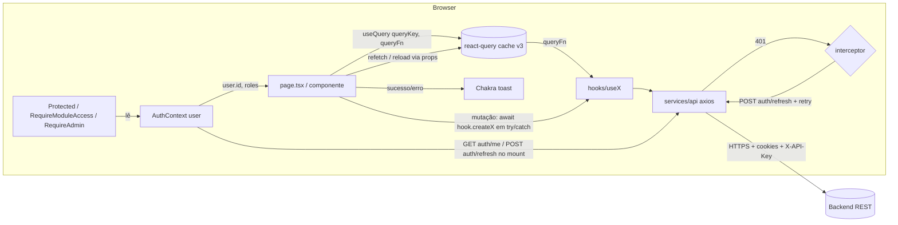
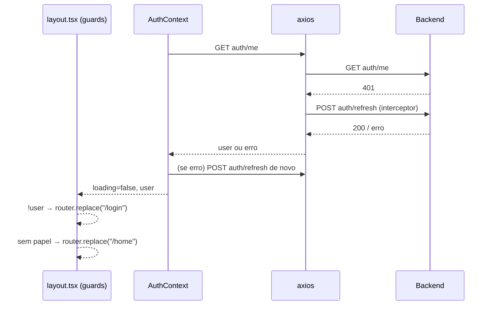

# Arquitetura do front-end

Este documento descreve o estado **atual** do código. Itens marcados com **(a confirmar)** não puderam ser verificados só pelo código.

## Visão geral

Aplicação Next.js 16 (App Router) totalmente client-side: toda página e todo layout começa com `"use client"`. Não há Server Components com dados, Route Handlers (`app/api`), Server Actions nem `middleware`. O front consome uma API REST externa (NestJS, outro repositório) via axios, com autenticação baseada em cookies (`withCredentials: true`).

Deploy: Vercel, com o backend no Railway (segundo o `README.md`).

## Organização de pastas

```
.
├── next.config.ts          reactCompiler: true
├── tsconfig.json           strict, alias @/* -> ./src/*
├── jest.config.js          ts-jest (jest não instalado, sem testes)
├── public/                 svgs padrão do Next + foto_perfil.png
└── src/
    ├── @types/react-color.d.ts     declare module "react-color"
    ├── global.d.ts                 declare module "*.css"
    ├── eslint.config.mjs           flat config (next core-web-vitals + typescript)
    ├── app/                        rotas (ver telas-e-componentes.md)
    │   ├── layout.tsx              RootLayout + providers
    │   ├── page.tsx                redirect("/login")
    │   ├── mytheme.ts              tema Chakra
    │   ├── login/  home/
    │   └── modules/<modulo>/...    páginas por módulo + layout.tsx com guards
    ├── componnents/                componentes (nome com "nn" é o real)
    │   ├── default-button.tsx  default-input.tsx  menu.tsx  menu-mobile.tsx
    │   ├── Protected.tsx  RequireAdmin.tsx  RequireModuleAccess.tsx
    │   ├── auth/           first-screen.tsx
    │   ├── financial/      painéis, movimentos, gráficos, modais financeiros
    │   ├── atividades/     tarefas (cards, modais, quadros)
    │   └── notificacoes/   notificacao-modal.tsx
    ├── contexts/AuthContext.tsx    único estado global
    ├── hooks/                      "serviços" por domínio (chamadas à API)
    ├── services/api.ts, apiSetup.ts   instância axios + interceptor
    ├── config/module-access.ts     papéis -> módulos
    ├── config/modules-nav.ts       lista de módulos da home
    ├── schemas/auth.schema.ts      schemas Yup
    ├── types/                      financial-types.ts, admin-types.ts
    └── utils/                      datas, moeda, CSS de scrollbar e do mini-calendário
```

Alguns tipos ficam dentro dos próprios hooks (`useTarefas.tsx`, `useNotifications.ts`) e não em `types/`.

## Camadas

| Camada | Onde | Responsabilidade |
|---|---|---|
| Rotas/Layouts | `src/app/**/layout.tsx` | Aplicar guards de autenticação e de módulo. Não há layout visual compartilhado. |
| Páginas | `src/app/**/page.tsx` | Montar shell (`Menu`/`MenuMobile`), disparar `useQuery`, controlar modais via `useState`/`useDisclosure`, tratar exclusões. |
| Componentes | `src/componnents/**` | UI. Muitos componentes de domínio fazem chamadas à API (modais salvam/excluem; gráficos têm seu próprio `useQuery`). |
| Hooks de domínio | `src/hooks/use*.ts(x)` | Funções async finas sobre o `api`; fazem conversões de payload (moeda → número, `"HH:MM"` → minutos, `string` → `Date`). Só o `useMovements` usa um hook React de verdade (`useQueryClient`). |
| Serviço HTTP | `src/services/apiSetup.ts` | Instância axios com `baseURL`, `X-API-Key`, cookies e refresh automático em 401. |
| Estado global | `src/contexts/AuthContext.tsx` | Usuário logado, `loading`, `signIn`, `signOut`, `updateUser`. |
| Config | `src/config/*` | Regras de acesso por papel e metadados de navegação. |

## Providers (`src/app/layout.tsx`)

```tsx
<html lang="pt-BR">
  <body className={geistSans + geistMono} style={{ height: "100vh", display: "flex", flexDirection: "column" }}>
    <ColorModeScript initialColorMode="light" />
    <AuthProvider>
      <QueryClientProvider client={queryClient}>   // new QueryClient() no escopo do módulo, opções padrão
        <ChakraProvider theme={myTheme}>{children}</ChakraProvider>
      </QueryClientProvider>
    </AuthProvider>
  </body>
</html>
```

Consequência: o `AuthProvider` fica **fora** do `QueryClientProvider` e do `ChakraProvider` e, por isso, não usa react-query nem toast.

## Fluxo de dados: da API até a tela



Sequência típica de uma tela:
1. O `layout.tsx` do módulo aplica `Protected` (redireciona para `/login` se não houver `user`) e `RequireModuleAccess` (redireciona para `/home` se o usuário não tiver o papel).
2. A página chama `useQuery` com uma `queryKey` que costuma incluir `user?.id` e os filtros. A `queryFn` chama o hook de domínio.
3. A UI lê `data?.data`, mostra `Spinner` enquanto `isLoading` e mensagens de lista vazia.
4. Ações de escrita abrem um modal; o modal chama o hook, mostra o toast, fecha e chama o `reload`/`refetch` recebido.

## Autenticação no cliente

- Não há token em `localStorage`/cookie acessível via JS. O código assume que o backend gerencia a sessão via cookies (`withCredentials: true`). Que sejam cookies httpOnly: **(a confirmar)**.
- **Bootstrap** (`AuthProvider`, `useEffect` no mount): `GET auth/me`; se falhar, `POST auth/refresh`; se falhar de novo, `user = null`. `loading` vira `false` no final.
- **Login**: `signIn` → `POST auth/login` e `setUser(response.data.user)`; depois `router.push("/home")`.
- **Logout**: `signOut` → `POST auth/logout` e `setUser(null)`. Os guards então redirecionam para `/login`. Se o POST falhar, o usuário não é limpo (o `Menu` chama `signOut()` sem `catch`).
- **Refresh automático** (`apiSetup.ts`): em resposta 401 (exceto na própria `auth/refresh` e em requisições já re-tentadas), faz `POST auth/refresh` e repete a requisição original. Requisições concorrentes ficam numa fila (`failedQueue`) enquanto o refresh roda. Se o refresh falhar, o erro é propagado; **não** há redirect nem logout global no interceptor.
- **Autorização**: `hasModuleAccess(user, moduleKey)` em `config/module-access.ts`. Os nomes dos papéis passam por remoção de acento e upper-case. `ADMIN` libera tudo. Mapeamento: `financeiro → FINANCEIRO`, `tarefas → TAREFAS`, `notificacoes → NOTIFICACOES`, `admin → ADMIN`. A mesma função filtra o menu, os cards da home e os guards.



Observação: no bootstrap, um `auth/me` com 401 já dispara o refresh do interceptor; se esse falhar, o `catch` do `AuthProvider` tenta `auth/refresh` mais uma vez.

## Tema e design system

Arquivo: `src/app/mytheme.ts` (`extendTheme`).

- **Color mode**: `initialColorMode: "light"`, `useSystemColorMode: false`. O usuário alterna no `Switch` "Modo escuro" do `Menu` desktop (`useColorMode().toggleColorMode`). A persistência usa o padrão do Chakra. O `Switch` do `MenuMobile` **não está ligado** a nada.
- **Paleta** (`colors`): nomes em português (`vermelho`, `verde700`, `cinza_*`, `menu_principal` `#1e293b`, `console_placa` `#182238`, `ambar` `#F5A623`, `fio`, `texto_frio`, ...).
- **Tokens semânticos** (com `_dark`):
  - `surface.canvas | card | hover | stripe.odd | stripe.even | taskActive | taskDone | overlay`
  - `text.primary | text.muted`
  - `border.default`
  - `accent.text`
- **Global**: `body { bg: surface.canvas; color: text.primary }`.
- **Fontes**: o tema declara `Roboto`, mas nenhuma folha da Roboto é carregada no código. O root layout carrega `Geist` e `Geist_Mono` via `next/font` como variáveis CSS (`--font-geist-sans`, `--font-geist-mono`), usadas explicitamente só na home. Se a Roboto aparece de fato no browser: **(a confirmar)**.
- **Breakpoints**: o tema adiciona `celular` (320px), `media` (1000px) e `grande` (1600px), mas o código usa os padrões `base/sm/md/lg/xl`. O ponto de virada principal é `lg`: o `Menu` lateral aparece a partir de `lg` e o `MenuMobile` (Drawer) abaixo dele.
- **Cores fixas**: gradientes e hex aparecem direto nos componentes (ex.: o `DefaultButton` usa `linear(to-r, #1e293b, #324565)`; os botões de exclusão usam `linear(to-r, #41150f, #650d0d)`; a home usa âmbar `#F5A623 → #d88a12`).
- **Gráficos Victory**: usam `VictoryTheme.clean` e variáveis CSS do Chakra (`var(--chakra-colors-text-primary)`, `var(--chakra-colors-surface-card)`) para respeitar o dark mode.
- **CSS global extra**: `src/utils/mini-calendar.css` (estilo do `DayPicker`, com regras `body.chakra-ui-dark`), importado só em `tarefas-semanais`. `ScrollBarcss` (`utils/scroll-bar-css.tsx`) esconde a scrollbar.

## Padrões e decisões visíveis no código

1. **Hooks como camada de serviço**: `useX()` devolve um objeto de funções async. Não guardam estado. Podem ser chamados em qualquer componente.
2. **react-query só para leitura**: escrita via chamadas diretas + `refetch`. A única invalidação explícita é `useMovements.refreshGraphics()` (`"graphics"` e `"salary"`).
3. **Modal único para criar/editar**, decidido por `item?.id`; exclusão dentro do mesmo modal (tarefas, categorias de tarefas, notificações) ou em `AlertDialog` de confirmação (painel, movimento, categoria financeira).
4. **Shell repetido por página**: cada `page.tsx` renderiza `<MenuMobile />` e `<Menu />` dentro de um `Flex` com `flexDir={{ base: "column", lg: "row" }}`.
5. **Guards por layout de módulo**; páginas públicas (`primeiro-acesso`, `recuperar-senha`) ficam em `modules/` mas sem `layout.tsx`. `financeiro/graficos` e `financeiro/movimentacoes` têm um `layout.tsx` próprio que envolve `Protected` de novo (redundante com o layout de `financeiro`).
6. **Tratamento de erro local**: `try/catch` + toast. Alguns status HTTP têm mensagem própria: 429 (login/recuperação), 409/404 (papéis), 413 (foto), 400/401 (senha atual errada). Não há `error.tsx`, `loading.tsx`, `not-found.tsx` nem Error Boundary.
7. **Formatação pt-BR** via `toLocaleString("pt-BR")` em todo lugar.

## Ferramentas e qualidade

- **Lint**: ESLint 9 com `eslint-config-next` 16.0.3 (`core-web-vitals` + `typescript`). O arquivo fica em `src/eslint.config.mjs`; se `npm run lint` na raiz o encontra: **(a confirmar)**.
- **Testes**: nenhum. `jest.config.js` (ts-jest, `testEnvironment: node`, transforma só `.ts`) existe, mas `jest`/`ts-jest` não estão no `package.json`.
- **Build**: as páginas `financeiro/movimentacoes`, `financeiro/categorias` e `tarefas/tarefas-semanais` usam `useSearchParams()` sem `<Suspense>`. Se `next build` gera aviso/erro por isso: **(a confirmar)**.
